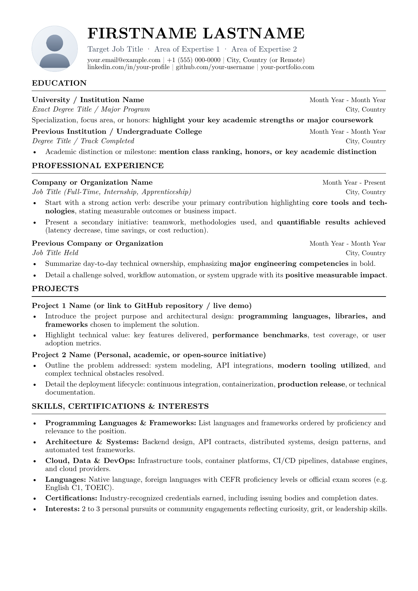
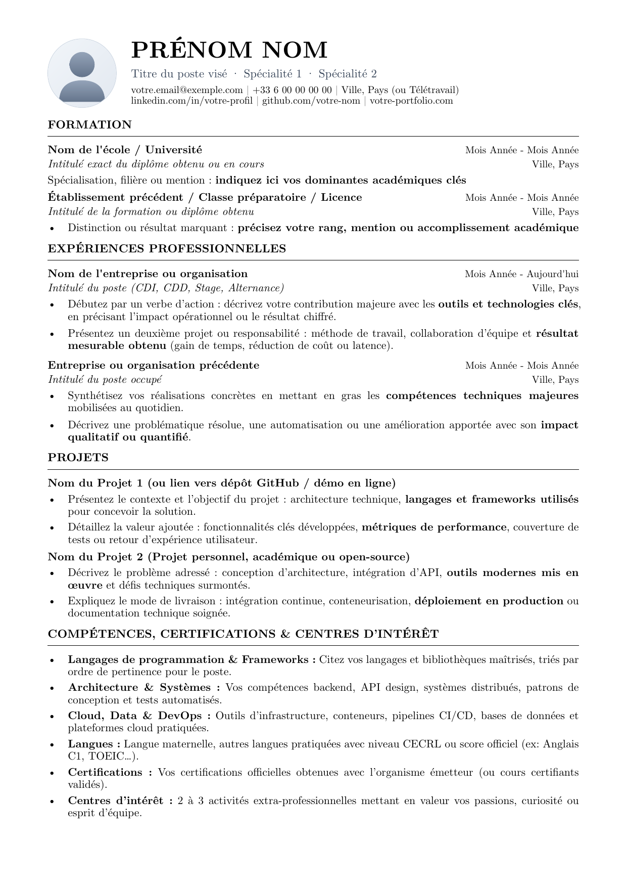

<div align="center">

# 📄 Minimalist & ATS-Friendly Typst CV Template

**A clean, LaTeX-inspired, single-page resume template designed for modern tech professionals.**  
*Available in English & French with optional top-left profile photo and automatic CI/CD compilation.*

[](https://typst.app/)
[](#-license)
[](#-automated-cicd-with-github-actions)
[](#)
[](#-ats--machine-readability)
[](CONTRIBUTING.md)

<p align="center">
  <a href="#-previews">Previews</a> •
  <a href="#-project-structure">Project Structure</a> •
  <a href="#-why-typst">Why Typst</a> •
  <a href="#-quick-start">Quick Start</a> •
  <a href="#%EF%B8%8F-customization">Customization</a> •
  <a href="#-makefile-commands">Makefile</a> •
  <a href="#-automated-cicd-with-github-actions">CI/CD</a> •
  <a href="#-llm--ai-tailoring-prompt">LLM Prompt</a>
</p>

</div>

---

## 🖼️ Previews

Each template includes **guided instructions** (action verbs, metrics, structure) instead of fake dummy text, showing you exactly how to craft each bullet point.

| English Version (`output/cv-en.pdf`) | French Version (`output/cv-fr.pdf`) |
| :---: | :---: |
|  |  |

---

## 📁 Project Structure

```text
.
├── assets/
│   ├── preview-en.png
│   └── preview-fr.png
├── output/
│   ├── README.md
│   ├── cv-en.pdf
│   └── cv-fr.pdf
├── src/
│   ├── assets/
│   │   └── avatar.svg
│   ├── cv-en.typ
│   ├── cv-fr.typ
│   └── template.typ
├── .gitignore
├── CONTRIBUTING.md
├── LICENSE-APACHE
├── LICENSE-MIT
├── Makefile
└── README.md
```

---

## 💡 Why Typst?

- **Instant Compilation**: Compiles in less than 30 milliseconds (over 100x faster than `pdflatex`).
- **Zero Heavy Dependencies**: No 5 GB TeX Live distribution required. Typst is a single lightweight binary (~25 MB).
- **Privacy by Default**: Generated PDFs are written to the gitignored `output/` directory so your personal details are never committed by mistake.
- **ATS Compliant**: Clean single-column layout, standard Unicode character encoding, and verified reading order for automated applicant tracking systems.
- **Strict 1-Page Format**: Balanced margins, leading, and spacing to guarantee a complete professional summary on a single A4 page.
- **Git Native**: Track your resume revisions with clean, human-readable diffs.
- **Flexible Photo Header**: Easily enable a top-left avatar, or disable it for a traditional centered LaTeX header.

---

## 🚀 Quick Start

### 1. Install Typst

```sh
# macOS / Linux (Homebrew)
brew install typst

# Arch Linux
pacman -S typst

# Windows (Winget)
winget install --id Typst.Typst

# Rust (Cargo)
cargo install --locked typst-cli
```

### 2. Compile Your Resume

```sh
# Using Make:
make en       # Compiles output/cv-en.pdf
make fr       # Compiles output/cv-fr.pdf
make          # Compiles both

# Or using Typst CLI directly:
typst compile src/cv-en.typ output/cv-en.pdf
typst compile src/cv-fr.typ output/cv-fr.pdf
```

Your compiled PDF is immediately saved in the `output/` directory.

### 3. Live Auto-Reload

Watch files and automatically recompile whenever you save:

```sh
make watch-en
# or
typst watch src/cv-en.typ output/cv-en.pdf
```

---

## 🛠️ Customization

Open `src/cv-en.typ` (or `src/cv-fr.typ`). Each file is self-contained and divided into two clear parts:

### Part 1: Contact Details & Photo

```typst
#let info = (
  author: "Alex DUPONT",
  title: "Senior Software Engineer · Distributed Systems · Cloud",
  email: "alex.dupont@example.com",
  phone: "+1 (555) 012-3456",
  location: "San Francisco, CA (or Remote)",
  linkedin: "linkedin.com/in/alex-dupont",
  github: "github.com/alexdupont",
  website: "alexdupont.dev",
  photo: "assets/avatar.svg", // Path to your photo ("assets/profile.jpg"), or 'none' to disable
)
```

- **Top-left Photo**: Set `photo: "assets/profile.jpg"`. Your photo appears in the top-left corner with your details aligned to its right.
- **No Photo (Classic Centered ATS)**: Set `photo: none`. The header automatically shifts to a centered single-column layout.
- **Photo Shape**: Configurable in `src/template.typ` (`50%` for circle, `4pt` for rounded rectangle, `0pt` for square).

### Part 2: Sections & Entries

```typst
#section("WORK EXPERIENCE")

#entry(
  "Acme Corp", "2023 - Present",
  "Senior Backend Engineer", "San Francisco, CA",
)
- Started with a strong action verb: described core achievements using *key technologies and tools*.
- Outlined a secondary responsibility: highlighted team collaboration and *quantifiable results* (e.g., reduced p99 latency by 35%).
```

---

## ⌨️ Makefile Commands

| Command | Description |
| :--- | :--- |
| `make en` | Compile English resume to `output/cv-en.pdf` |
| `make fr` | Compile French resume to `output/cv-fr.pdf` |
| `make` / `make all` | Compile both English and French versions |
| `make watch-en` | Live auto-reload on save (English) |
| `make watch-fr` | Live auto-reload on save (French) |
| `make check` | Verify strict 1-page budget and test text extraction |
| `make previews` | Regenerate preview PNG images in `assets/` |
| `make clean` | Remove compiled PDFs from `output/` |

---

## 🤖 Automated CI/CD with GitHub Actions

This repository includes a turnkey GitHub Actions workflow (`.github/workflows/ci.yml`):

1. **Automatic Build & Test**: On every `git push` or pull request, GitHub Actions compiles both resumes using the official Typst toolchain.
2. **Strict 1-Page Check**: The CI workflow fails if any resume exceeds a single page.
3. **Artifact Upload**: Download the compiled `cv-en.pdf` and `cv-fr.pdf` directly from the GitHub Actions run.
4. **Automated Releases**: Push a git tag (e.g. `git tag v1.0.0 && git push --tags`) and GitHub will automatically create a Release with the PDFs attached.

---

## 🔍 ATS & Machine Readability

Test how ATS parsers extract text from your generated PDF:

```sh
# 1. Verify strict 1-page count
pdfinfo output/cv-en.pdf | grep Pages

# 2. Extract plain text in natural reading order
pdftotext -layout output/cv-en.pdf -

# 3. Check embedded vector fonts
pdffonts output/cv-en.pdf
```

---

## 🧠 LLM / AI Tailoring Prompt

To tailor this resume for a specific job description using Claude, ChatGPT, or Gemini, copy and paste this prompt:

<details>
<summary><b>Click to expand the AI prompt</b></summary>

```markdown
I have a single-page CV in Typst. Here is my current `src/cv-en.typ` (or `src/cv-fr.typ`):
<PASTE YOUR CV FILE HERE>

Here is the job description I am targeting:
<PASTE JOB DESCRIPTION HERE>

Please adapt the bullet points in my CV to match this job offer by:
1. Highlighting relevant technical keywords (bolding 1-2 distinct skills or metrics per bullet).
2. Starting each bullet with a strong action verb and including quantifiable impact/metrics.
3. Keeping the exact same Typst syntax (#section, #entry, #let info).
4. Ensuring the total content length stays compact enough to strictly fit on a SINGLE A4 page.
```

</details>

---

## 🤝 Contributing

Contributions and feedback are welcome. Please check our [Contributing Guidelines](CONTRIBUTING.md) to get started.

---

## 📜 License

Dual-licensed under [MIT](LICENSE-MIT) or [Apache-2.0](LICENSE-APACHE), at your option.

<div align="center">
  <sub>Built with Typst. If you find this template useful, please consider starring the repository.</sub>
</div>
